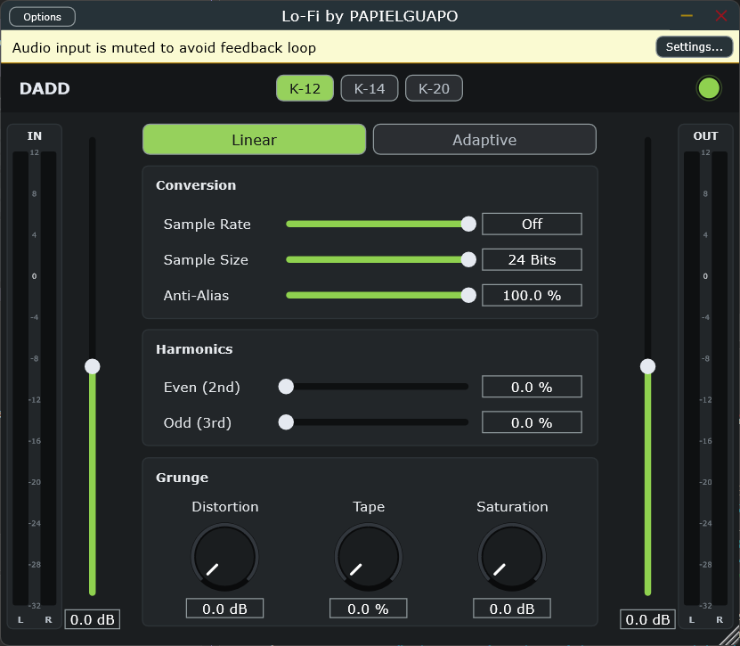

# DADD - Digital Audio Degradation Device

Guia de uso con explicacion de cada control: [docs/GUIDE.md](docs/GUIDE.md)

## Descargar

- [DADD-v1.0.0-VST3-Windows.zip](download/DADD-v1.0.0-VST3-Windows.zip) (VST3 para Windows 64 bits)
- Tambien en [Releases](https://github.com/papielguapo/DADD-Digital-Audio-Degradation-Device/releases/latest)

Instalacion: descomprime y copia la carpeta DADD.vst3 a C:\Program Files\Common Files\VST3, luego vuelve a escanear plugins en tu DAW.

Plugin VST3 / Standalone lo-fi hecho con JUCE por PAPIELGUAPO.

- Reduccion de Sample Rate (1000-48000 Hz u Off) y Sample Size (1-24 bits)
- Cuantizacion Linear / Adaptive y Anti-Alias
- Distorsion, saturacion, Tape y armonicos pares/impares
- Trim de entrada y salida, medidores K-System (K-12 / K-14 / K-20)
- Bypass con crossfade y sobremuestreo 2x

## Compilar
Abrir el .jucer con Projucer (JUCE 8), exportar a Visual Studio y compilar Release x64.

## AU (macOS)
El workflow .github/workflows/build-au.yml compila el AU en un runner de macOS y sube el .component como artefacto (pestana Actions).

## AAX (Pro Tools)
Requiere el SDK de AAX de Avid y firma PACE/iLok. Pasos: descargar el SDK, en Projucer anadir su ruta en Global Paths (AAX SDK), activar buildAAX en pluginFormats y exportar a Visual Studio.

