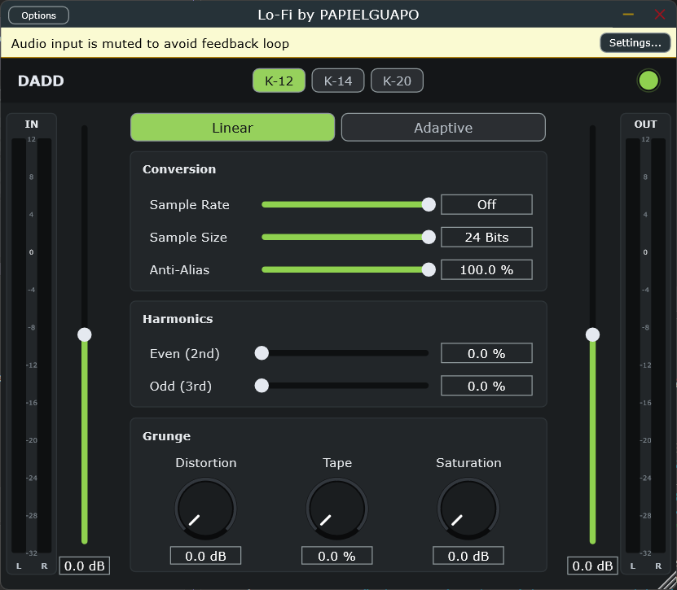

# Guía de uso de DADD

**DADD (Digital Audio Degradation Device)** degrada el audio de forma controlada: reduce la resolución y la frecuencia de muestreo, añade distorsión, saturación y carácter de cinta. Sirve para darle sonido lo-fi, sucio o vintage a baterías, samples, bajos, voces o a toda la mezcla.

## Cómo usarlo
1. Inserta DADD como efecto en una pista o en el bus que quieras degradar.
2. Ajusta **Trim IN** hasta que el medidor IN marque un nivel razonable.
3. Empieza por **Conversion** para el carácter digital y sigue con **Harmonics** y **Grunge** para el color.
4. Ajusta **Trim OUT** para igualar el volumen con la señal original y compara con el botón de bypass.

## Secciones

### Barra superior
- **K-12 / K-14 / K-20:** escala de los medidores, según el sistema K de Bob Katz. K-12 es la más habitual para música moderna y es la escala por defecto.
- **Led verde (arriba a la derecha):** bypass. Apagado, la señal pasa sin procesar, con una transición suave para evitar clics.

### Medidores IN y OUT
- Muestran el nivel de entrada y de salida, canal L y R, con nivel RMS y picos.
- **Trim IN (slider a la derecha del medidor IN):** ganancia de entrada, de -24 a +24 dB. Se aplica antes del medidor y del procesado. Más nivel de entrada produce más distorsión y saturación.
- **Trim OUT (slider a la izquierda del medidor OUT):** ganancia final, de -24 a +24 dB. Doble clic en cualquier slider para volver a 0 dB.

### Linear / Adaptive
Modo de cuantización (reducción de bits):
- **Linear:** cuantización uniforme. Sonido digital clásico y áspero.
- **Adaptive:** adapta la cuantización a la señal. Es algo más suave y musical.

### Conversion
| Control | Qué hace | Rango |
|---|---|---|
| **Sample Rate** | Reduce la frecuencia de muestreo, lo que genera aliasing y un sonido "crujiente". **Off** (por defecto) lo desactiva. | 1000 Hz a 48000 Hz, u Off |
| **Sample Size** | Reduce los bits de resolución. Menos bits significan más ruido de cuantización. | 1 a 24 bits |
| **Anti-Alias** | Mezcla de filtro anti-aliasing antes de reducir el sample rate. Al 100 % el sonido es más limpio; al 0 % es más agresivo. | 0 a 100 % |

Punto de partida lo-fi: Sample Rate 12000 Hz, Sample Size 8 bits, Anti-Alias 50 %.

### Harmonics
- **Even (2nd):** armónicos pares. Aportan calidez, al estilo de las válvulas.
- **Odd (3rd):** armónicos impares. Aportan más mordiente y presencia.

### Grunge
- **Distortion:** distorsión con ganancia en dB.
- **Tape:** emulación de cinta, con saturación suave, compresión de picos y pérdida de agudos.
- **Saturation:** saturación suave que añade densidad.

## Recetas rápidas
| Efecto | Ajustes |
|---|---|
| Cinta vieja | Tape 60 %, Even 30 %, Sample Rate Off |
| Sampler de 8 bits | Sample Size 8, Sample Rate 16000 Hz, Linear |
| Radio / teléfono | Sample Rate 6000 Hz, Sample Size 10, Distortion 6 dB |
| Calidez suave en la mezcla | Saturation 3 dB, Even 20 %, Tape 20 % |

### Recetas con Even / Odd
| Efecto | Ajustes |
|---|---|
| Calidez de valvula en voces | Even 40 %, Odd 0 %, Saturation 2 dB |
| Mordiente en guitarras o sintes | Even 10 %, Odd 45 %, Distortion 4 dB |
| Bajo con cuerpo y definicion | Even 30 %, Odd 15 %, Tape 20 % |
| Bateria con pegada | Even 20 %, Odd 35 %, Saturation 3 dB |
| Brillo sutil en el bus master | Even 15 %, Odd 10 %, Tape 15 % |

Even (pares) suma calidez y redondez; Odd (impares) suma mordiente y presencia. Combinalos para equilibrar ambas cosas.

Los valores son orientativos: prueba y ajusta de oído.

## Instalación
- **VST3:** copia `DADD.vst3` a `C:\Program Files\Common Files\VST3` y vuelve a escanear plugins en tu DAW.
- **Standalone:** ejecuta `DADD.exe`.
